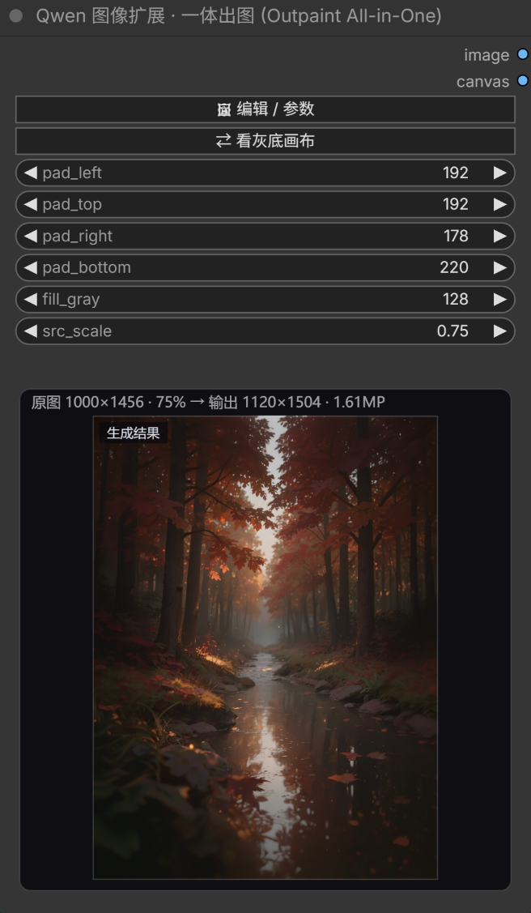
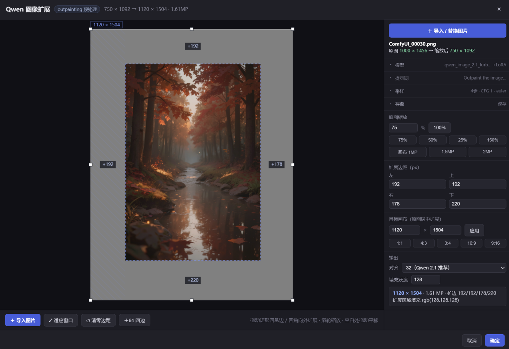
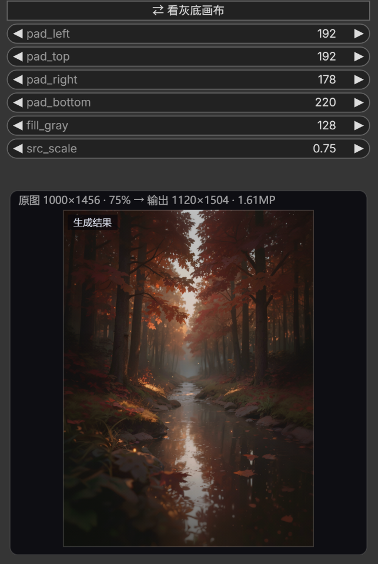
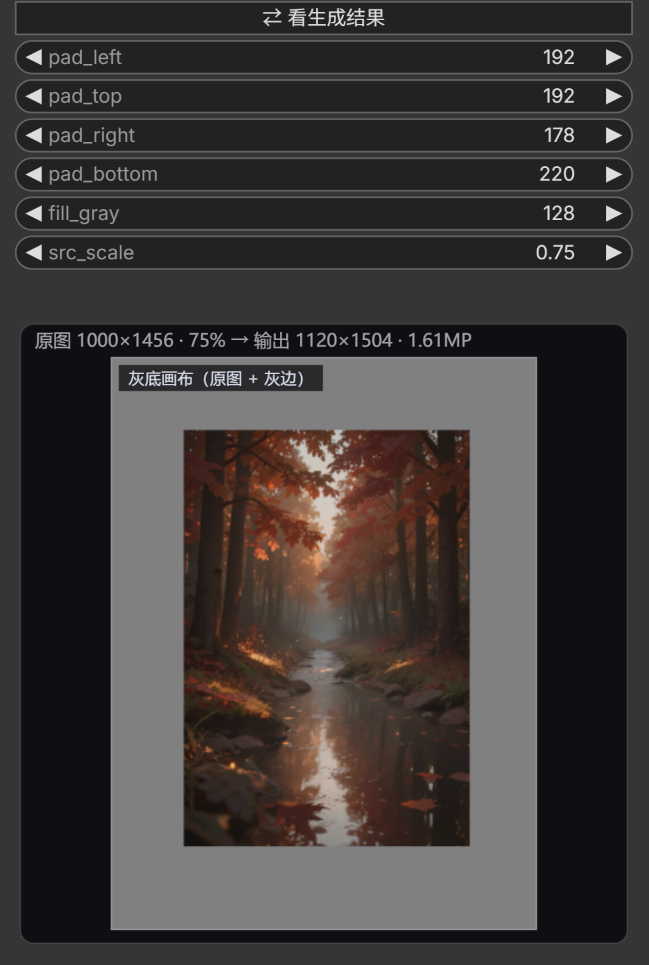
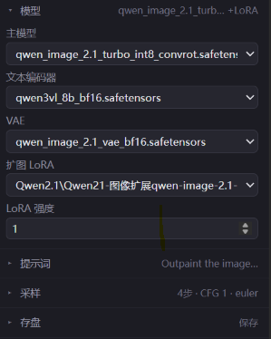
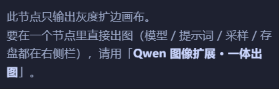

# ComfyUI-QwenImageExpand

[](https://github.com/wanet36/ComfyUI-QwenImageExpand/actions/workflows/tests.yml)
[](LICENSE)

**中文**（本文件） · **English** → [README_EN.md](README_EN.md)

给 **Qwen-Image 2.1 扩图（outpainting）** 用的两个节点，共用同一套可视化编辑器
（导入图片 → 拖动矩形外扩 → 延伸区域填 `rgb(128,128,128)` = `#808080`）：

| 节点 | 做什么 | 适合 |
| --- | --- | --- |
| **Qwen 图像扩展 (Image Expand)** | 只出「灰度扩边画布」 | 想自己接线、换模型、精细控制采样 |
| **Qwen 图像扩展 · 一体出图 (Outpaint All-in-One)** | 加载模型→扩边→编码→采样→解码→存盘，全在一个节点里；**模型 / 提示词 / 采样 / 存盘都在右侧栏最上面** | 想一键出图（等价于下面那条 10 节点链路） |

> 两个节点名字相近：只出画布的那个，页面右侧会有一条虚线提示引导你去用「一体出图」。

## 安装

```bash
cd ComfyUI/custom_nodes
git clone <this-repo> ComfyUI-QwenImageExpand
# 重启 ComfyUI
```

无额外依赖（只用 PIL + numpy，ComfyUI 自带）。两个节点都在 `image/expand` 分类下。



> 节点上第二个按钮 `⇄` 用来在「生成结果」和「原图（灰底画布）」之间切换；左下卡片一次只显示一张图。

## 使用

1. 添加节点 → 点按钮 **🖼 打开扩展编辑器**
2. 页面里点 **＋ 导入图片**（也可以直接把图片拖进页面）
3. （可选）**原图缩放**：侧栏填百分比（50% / 75% / 150%…），或点 **画布 1MP / 1.5MP / 2MP**
   按目标总像素反算缩放 —— 大图先缩到 LoRA 训练范围再扩边，画布才不会飙到 6MP
4. 图片被矩形框住，拖动矩形四条边 / 四角**向外拉**：
   - 拉出来的区域立刻变成 128 灰（就是输出里模型要"补画"的部分）
   - 侧栏实时显示输出尺寸、MP 与四边扩展量
5. （可选）用 **目标画布** / **1:1 / 4:3 / 16:9 …** 一键把原图居中扩展成标准尺寸
6. 点 **确定** → 节点输出 `IMAGE`



> 上图的右侧栏用的是**「一体出图」节点**（所以有 模型 / 提示词 / 采样 / 存盘 四组）；
> 只出画布的「Qwen 图像扩展」节点没有这四组，其余部分（导入、缩放、扩展边距、目标画布、输出）完全一样。

## 节点参数

| 参数 | 说明 |
| --- | --- |
| `pad_left` / `pad_top` / `pad_right` / `pad_bottom` | 四边扩展像素（编辑器自动写回，也可手改） |
| `fill_gray` | 扩展区域灰度，默认 `128` = `rgb(128,128,128)` |
| `expand_json` | 原图文件名 / 尺寸 / 缩放 / 对齐等状态（自动维护，勿手改） |
| `src_scale` | 原图缩放倍数，默认 `1.0`（0.05–8）：先缩放再扩边，画布 = 原图 × scale + 四边 pad |

输出：**IMAGE**（尺寸 = 原图 × `src_scale` + 四边 pad），单输出口，直接接 Qwen-Image 2.1 的编码器。

> 缩放用 LANCZOS 重采样，取整规则与前端一致（半像素向上），所以编辑器里看到的尺寸就是实际输出尺寸。

## 一体节点：Qwen 图像扩展 · 一体出图 (Outpaint All-in-One)

把「UNET / CLIP / VAE / LoRA 加载 + 灰度扩边 + Text Encode Qwen Image 2.1 + KSampler +
VAE Decode + 存盘」整条链路收进一个节点。开箱工作流见 `examples/qwen21_outpaint_single.json`
（拖进 ComfyUI 即可，参数与原 10 节点版一致）。

**节点是「结果卡片」，参数全在编辑器右侧栏**：

| 区域 | 内容 |
| --- | --- |
| 节点本体 | `🖼 编辑 / 参数` + `⇄ 看灰底画布 / 看生成结果`（切换按钮）+ **扩边 6 项**（`pad_left` / `pad_top` / `pad_right` / `pad_bottom` / `fill_gray` / `src_scale`，与「Qwen 图像扩展」节点同名同序，行为一致）+ 卡片（`原图 W×H → 输出 W×H · MP`、生成进度条、单图预览） |
| 编辑器 · 画布 | 导入图片 / 缩放 / 拖动扩边 / 目标画布 / 对齐 / 填充灰度 |
| 编辑器 · 右侧栏 | 顶部吸顶「＋ 导入 / 替换图片」；**四组折叠面板**：**模型**（主模型/编码器/VAE/LoRA/强度）、**提示词**（正/反向）、**采样**（种子+随机/步数/CFG/采样器/调度器/参考图分辨率）、**存盘**（开关/前缀），摘要行显示当前值；下面才是 原图 / 缩放 / 扩展边距 / 目标画布 / 输出尺寸 |


**卡片一次只显示一张图，用 `⇄` 按钮切换**：

| 按钮文案 | 当前显示的图 |
| --- | --- |
| `⇄ 看灰底画布` | 显示**生成结果**（默认；生成完自动切到这里） |
| `⇄ 看生成结果` | 显示**原图 + 128 灰边的画布**（送进模型的那张） |
| `⇄ 看生成结果（还没生成）` | 还没跑过，只有画布可看 |

按钮文案是「点了会看到什么」，卡片左上角的标签写着当前这张是 `生成结果` 还是 `灰底画布（原图 + 灰边）`。
开始生成时会自动切回画布（方便看进度），生成完再自动切到结果。







「只出画布」那个节点的页面右侧是这条提示（引导到一体节点）：



**实现要点**（都是踩过的坑）：
- 模型/提示词/采样/存盘仍是节点 widget（`widgets_values` 照常随工作流保存），只是用 `computeSize=[0,-4]` + `display:none` 在节点上隐藏；扩边 6 项照原样显示在节点上。
- 后端 `ui` 用自定义 key `qie_preview` 而不是 `images`：否则前端会在节点下方再挂一张大图，和卡片重复。
- 节点内部采样时临时 `latent_preview.set_preview_method("none")`，避免采样预览图糊在卡片上（跑完恢复原设置）。
- 切换按钮就是个 `addWidget("button", ...)`（`serialize=false`，不进工作流），状态存在节点实例的
  `__qieView`（`"result"` / `"canvas"`），卡片按 `viewMode()` 决定画哪张；没有结果时强制回 `canvas`。
- 直接调上游 `nodes.UNETLoader/CLIPLoader/VAELoader/LoraLoader`、`common_ksampler`、
  `TextEncodeQwenImage21.execute(...).result`、`QwenImage21Cache`、`VAEDecode`、`SaveImage`，不复制算法。
- 模型权重按「文件名 + LoRA + 强度」缓存在进程内，改 seed/prompt 不会重新加载 20GB；换模型先 `soft_empty_cache()`。
- `OUTPUT_NODE = True`：节点自己存盘，不接下游也要执行。
- hidden 输入不能叫 `prompt`（会和文本框撞名，被整份 API prompt 覆盖），只声明 `extra_pnginfo`。

**等价性**：同参数（seed 984328985342203 / 4 步 / pads 551-17-551-17 / scale 0.658）下，
一体节点与 10 节点工作流输出尺寸一致（1760×992），逐像素差异（平均 0.44）**小于同一条链路
自己跑两次的差异**（平均 4.87）—— 差异来自 Qwen 2.1 本身（int8 + KV cache 非确定性）。

## 配合 Qwen-Image-2.1-Outpaint-LoRA

节点就是为 [ausboss/Qwen-Image-2.1-Outpaint-LoRA](https://huggingface.co/ausboss/Qwen-Image-2.1-Outpaint-LoRA) 准备的，
该 LoRA 对输入图的硬性要求（照模型卡）：

| 要求 | 说明 | 本节点 |
| --- | --- | --- |
| **灰底 #808080** | 原图以外全部填平灰，LoRA 把灰当作待补全区域 | ✅ 默认 `fill_gray=128` |
| **画布是 32 的倍数** | 训练在 /32 网格上 | ✅ 默认对齐 32 |
| **总像素 1–2 MP** | v1 训练 ≈1MP，v2 为 1–2MP，更大未测试 | ⚠ 输出 >2MP 时侧栏告警 |
| **原图位置不动** | LoRA 保证已知区域像素级不动，便于回贴 | ✅ pad 不缩放原图 |
| **参考图与输出同尺寸** | 编码器 `resolution = 0` | ✅ 输出即画布尺寸 |

完整接线（官方推荐的 ComfyUI 流程）：

```
Load Image ─► 缩放图像(总像素, resolution_steps=32, 1.0~2.0MP) ─► 本节点(32 栅格)
  ─► Text Encode Qwen Image 2.1（image_1=画布, resolution=0, prompt）
  ─► KSampler（25 steps / CFG 1 / euler / simple / denoise 1）
  ─► VAE Decode ─► Split Image with Alpha ─► Stitch Inpaint（32px feather 回贴原图像素）
```

**Prompt**：第一句必须是触发句，后面可跟 `Scene: <画面描述>`（可用 Qwen3-VL 自动写）：

```
Outpaint the image: replace the solid gray areas with a seamless continuation of the scene, keeping the existing picture unchanged.
```

**坑**：
- **不要**用 `Set Latent Noise Mask` 去"固定"已知区域 —— Qwen 2.1 上会在接缝处画出可见矩形，LoRA 自己就能让原图不动。
- 保留面积小于 ~15%（扩得极狠）时不稳，分两次扩，或改用 v1。
- 纯色背景（棚拍白墙、纯天空）新区域可能出现软糊竖条；浅景深照片的楔形区会继承原图的模糊。
- 新区域里的文字"看着像字但读不出来"，属正常。
- 许可：Qwen Research License，**仅非商业**。

## 通用要点

- **扩展区域是纯 128 灰**，别改成黑/白，否则容易被当成画面内容。
- **32 栅格对齐**：输出宽高默认自动对齐到 32（可切 16 / 8 / 64 / 不对齐）。
  原图本身不是 32 倍数时，侧栏会提示，可用「目标画布」一键对齐；四边拉回 0 时不做对齐（0 就是 0）。
- 一次只扩一边也没问题（比如只往右拉），另一边天然贴合原图，不会多加灰边。

## 排错

**出图只有 32×32 / 很小的图？**
`Text Encode Qwen Image 2.1` 的 `resolution` 是「参考图目标尺寸」，填 32 就是把参考图缩成 32×32，
输出自然也是 32×32（实测：同一工作流 resolution=32 → 32×32，改成 0 → 1056×1504）。
这个 LoRA 要填 **0**：保持画布原尺寸，内部按 32 取整。
⚠️ 它和「缩放图像（总像素）」里的 `resolution_steps` 完全不是一回事，后者只是取整步长。

**输出比画布少 1~31px、原图位置偏了？**
画布没对齐 32。编辑器点「确定」时会自动对齐；也可用「目标画布」或比例按钮重排一次。

**接了 LoRA 还是有接缝 / 人物重复？**
确认没接 `Set Latent Noise Mask`（Qwen 2.1 上会画出可见矩形）；LoRA 强度 1.0、CFG 1；
想要原图像素完全不动，可在 VAE Decode 之后自己做一次原图回贴（模型卡里的 Stitch Inpaint）。

## 编辑器操作

| 操作 | 效果 |
| --- | --- |
| 拖动矩形边 / 角 | 向外扩画布，向内收缩（最小回到原图尺寸） |
| 滚轮 | 缩放视图 |
| 拖动空白处 | 平移视图 |
| `Esc` | 关闭（有改动会二次确认） |
| 侧栏「原图缩放」 | 百分比输入 / 75%·50%·25%·150% 快捷键 / 按画布 MP 反算 |
| 侧栏「左/上/右/下」 | 精确输入扩展像素，自动按栅格对齐 |
| 侧栏「目标画布」+ 比例按钮 | 原图居中扩展到指定尺寸 / 比例 |
| 「＋64 四边」/「清零边距」 | 快速四边均匀加边 / 复位 |

## 示例工作流

`examples/` 下两个可直接拖进 ComfyUI 的工作流（节点参数已调好）：

| 文件 | 内容 |
| --- | --- |
| `qwen21_outpaint_single.json` | 极简：只放一个「一体出图」节点 |
| `qwen21_outpaint_workflow.json` | 拆解版：UNET / CLIP / VAE / LoRA 加载 + 本节点 + Text Encode Qwen Image 2.1 + KSampler + VAE Decode + SaveImage，右侧另带一个未接线的「一体出图」做对照 |

两个工作流都引用 `input/qwen_image_expand/ComfyUI_00031.png`（我测试用的照片）。
**打开后请先点「＋ 导入 / 替换图片」换成你自己的图**，否则原图丢失时节点会退化成纯灰画布。
`qwen21_outpaint_workflow.json` 还用到 rgthree 的 `Image Comparer`，没装该插件时删掉那个节点即可。

## 测试

```bash
python tests/test_expand.py   # 后端：灰度填充、像素对位、JSON 容错、路径穿越、节点端到端
node   tests/test_editor.js   # 前端：导入、缩放、拖动外扩、比例预设、写回、预览（jsdom，68 断言）
python tests/api_smoke.py     # 真机：向运行中的 ComfyUI 提交节点 → SaveImage，校验尺寸/灰度
node   tests/cdp_ui.mjs       # 真机 UI：无头 Chrome 里建节点、开弹窗、缩放、真实拖动边框、写回、旧档兼容（26 断言）
node   tests/test_editor_params.js  # 参数面板：四个分组、控件取值、确定写回、随机种子、取消不回写、视图切换（29 断言）
node   tests/cdp_pipeline.mjs # 一体节点真机：卡片形态、参数隐藏仍序列化、拖动→写回→graphToPrompt→真跑一次→默认结果 / 按钮切到画布 / 再切回结果（26 断言）
```

后两个需要 ComfyUI 在 `127.0.0.1:8188` 运行、插件已装进 `custom_nodes`，
且 `input/qwen_image_expand/api_test.png` 已存在（`api_smoke.py` 会自动生成）。
GitHub Actions（`.github/workflows/tests.yml`）跑前三个：后端 `test_expand.py` + 两个 jsdom 测试。

## 目录结构

```
ComfyUI-QwenImageExpand/
├─ __init__.py            # 节点注册 + WEB_DIRECTORY
├─ nodes.py               # 节点定义（IMAGE 输出）
├─ expand.py              # 灰度扩边核心逻辑（纯 PIL，可独立测试）
├─ pipeline.py            # 一体节点（加载模型 → 扩边 → 编码 → 采样 → 解码 → 存盘）
├─ web/js/qwen_image_expand.js   # 编辑页面（导入 / 外拉矩形 / 参数面板 / 节点卡片）
├─ examples/              # 开箱工作流（单节点版 / 10 节点拆解版）
├─ docs/                  # README 截图
├─ tests/                 # 后端 + 前端 + 真机测试
├─ pyproject.toml         # ComfyUI Registry 元数据
├─ README_EN.md           # 英文说明
├─ .github/workflows/     # CI（后端 + jsdom）
└─ LICENSE                # MIT
```

## 已知限制

- 单张图片：一次只处理一张（多张请用多个节点）。
- 节点自身不生成提示词，扩图指令写在 Qwen-Image-Edit 的 prompt 里。
- 照片方向（EXIF）在浏览器端已按浏览器解码结果为准，后端按像素原样贴图。
